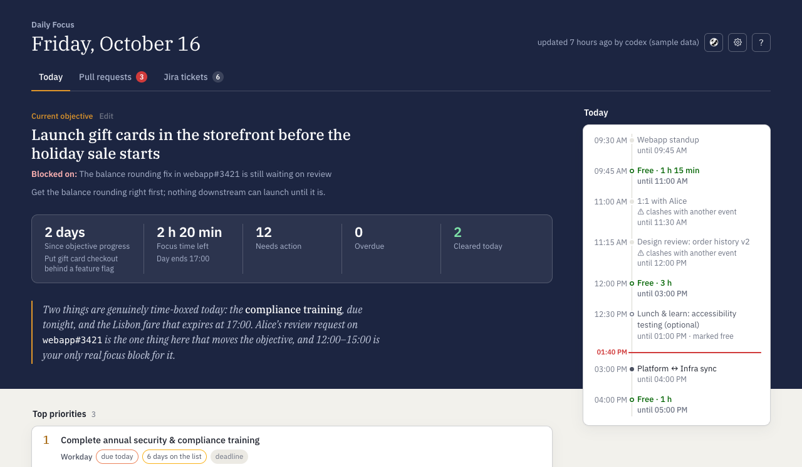

# Daily Focus

A personal dashboard for deciding what to work on today. Keep it in a pinned tab
for your priorities, meetings, open pull requests, and Jira tickets. See how it
works at [dailyfocus.dev](https://dailyfocus.dev).

[](https://dailyfocus.dev)

*The Today tab with fictional sample data.*

**On a Mac, [download the app](https://github.com/watson/daily-focus/releases/latest/download/Daily-Focus.dmg)**
instead of using npm. It runs Daily Focus from the menu bar and brings everything
it needs. The npm package is for Linux and Windows, and for running Daily Focus
yourself.

A morning agent gathers updates from your connected tools and writes a short brief.
You set the objective; the agent helps you choose work that moves it forward.
Mark an item done, snooze it, or leave a note, and the next brief takes that into
account. GitHub and Jira boards refresh throughout the day.

## Try it

On a Mac, download `Daily-Focus.dmg` from the
[latest release](https://github.com/watson/daily-focus/releases/latest) and drag the
app to Applications. It needs Apple silicon and macOS 13.5 or newer. It lives in
the menu bar, keeps the dashboard running, tells you when a new brief arrives, and
updates itself. It carries everything it needs, Node.js and the calendar helper for
the live agenda included. On Linux or Windows, or to run it yourself on a Mac, you'll
need Node.js 22.18 or newer (Node 24 is recommended):

```sh
npx daily-focus
```

Either way, a new store opens on the setup screen: a few questions, one at a time,
each with the likely answer already ticked. Once you've chosen the coding-agent CLI
that writes the brief (Claude Code or Codex), it looks into the rest for you, such
as which of your calendars are work ones, so most answers are a click. Everything
stays on the settings page afterwards.

The [setup guide](https://dailyfocus.dev/setup/) covers what you need, keeping the
dashboard running, and signing in to GitHub, Jira and your calendar. The dashboard
runs locally; nothing about your day leaves your machine except through the CLI you
choose.

## Your day at a glance

The **Today** tab puts your objective and top priorities beside your agenda.
It shows meeting conflicts, free time for focused work, and how long it has been
since you completed something that advanced your objective.

- Mark tasks **Done** when you've handled them.
- **Snooze** an item until a date, or **Dismiss** it if it doesn't need attention.
- Leave a **Note** for the next brief, such as "already replied on Slack".

You can undo item actions except notes. The page updates as new data arrives, and
the theme button opens a menu to pick light or dark mode, or follow the system.

## The pull request board

The second tab shows your open pull requests in seven buckets:

| Bucket | What it means |
|---|---|
| Waiting on you | A failure, conflict, requested change, outdated branch, or new activity needs your attention. |
| Ready to merge | Required reviews and checks are satisfied, and GitHub allows the merge. |
| Waiting on reviewers | A review is still needed, by GitHub or by a merge gate that says approvals are all it's missing. The board flags when it may be time to ask. |
| Waiting on merge gate | A check you've configured as a merge gate is pending for some other reason. |
| Merge blocked by GitHub | GitHub reports a policy block without an unfinished check to explain it. |
| Waiting on checks | Checks are running, or GitHub reports an unstable merge. |
| Drafts | Pull requests you haven't marked ready for review. |

Snooze a pull request until a date, leave a note, or click **Nudged** after asking
for a review. Nudged records that you asked; it doesn't send a message. The pull
request moves to a Nudged section for a day, then goes back to Waiting on reviewers
with "time to ask" if nobody has reviewed it. Completing a task about a pull
request in the brief doesn't remove that pull request from the board.

Cancelled checks appear as "cancelled, no verdict" rather than failures.
When a check is rerun, the board uses its newest workflow run or attempt.

## The Jira ticket board

The third tab helps you spot statuses that may need updating. Its **Out of sync**
view has three buckets:

| Bucket | What it means |
|---|---|
| No open pull requests left | Linked pull requests are closed, but the ticket isn't done. Check whether any work remains. |
| Work has started, the ticket has not | A pull request is open while the ticket still has a not-started status. |
| In flight with nothing linked | The ticket is in progress with no linked pull request. This can be fine for work that isn't code. |

Draft pull requests count as open. Closed pull requests don't prove that a ticket
is finished, so the board leaves that decision to you. Snooze the ticket until a date or
leave a note when there's more work planned.

Jira can take days to hear that a pull request merged, so the board also checks
GitHub. It searches your open pull requests and the ones closed in the last 60
days, and matches them to tickets by the key in the title, branch, description
or commit messages. An open pull request on GitHub always counts. GitHub can
also mark a ticket's pull requests as all closed, but only when it found at least
as many as Jira has linked. A row that GitHub changed lists those pull requests
under **GitHub, ahead of Jira**.

Switch to **Working on** to see your in-progress tickets grouped by status,
including ones that also need a status check. To narrow it, set **Statuses that
mean working on it** under **Jira tickets** in the settings.

**Clicking a ticket's status changes it in Jira.** The menu lists statuses seen in
your projects; Jira may refuse a move that your workflow doesn't allow. Make
transitions that need extra fields in Jira itself. Undo requests a transition back,
so both moves remain in Jira's history.

## Ask the assistant

Some items are a question away from being handled: is this review comment right,
why is CI red, what does this thread actually want from me. With
`DAILY_FOCUS_ASSISTANT` set to `claude` or `codex`, every item's panel gets an
assistant that runs that CLI headless against the item, with quick actions for the
common asks and a field for anything else. Click a card to open its panel, where its
notes live too. While the assistant works, the panel shows what it is doing: each
command it runs and each page, thread or ticket it reads, with a clock, and a cross
on anything that failed, such as a repository it couldn't see. Once it answers,
that trail folds away under the answer. The answer has buttons to copy it, or any
block in it meant for pasting, and to open a draft it created. The field stays at
the foot of the panel, so you can follow up in the same conversation. The panel
stays on the item it was opened for while you move through the list.

It can also answer before you ask. With **Answer ahead** on in the settings, when a
pull request starts waiting on you because someone reviewed it or a check failed,
the assistant assesses the review or explains the failure on its own. The first
line of its answer appears on the row, such as "Flaky, not yours: the Safari job
timed out", so the card already says what to do. It asks about each state once,
one at a time, and no more than ten times a day unless you change the limit.

It is told to read and draft, and nothing more. An email reply is created as a Gmail
draft on the thread, so it is waiting there when you open the mail; a reply to a
reviewer is handed back as text for you to post. It is told never to send, post, or
edit a file, and it has no checkout: fixing conflicts or a build is work for a real
coding session, and this is for the questions you would otherwise answer by opening
six tabs. How much of that the CLI itself enforces differs between Claude Code and
Codex; see [What the agent and the assistant can do](#what-the-agent-and-the-assistant-can-do).

## The morning agent

With `DAILY_FOCUS_AGENT` set to `codex` or `claude`, the dashboard runs the morning
agent itself through that CLI: at 07:00 each scheduled morning, or the time you set
in `DAILY_FOCUS_AGENT_AT`, and from the refresh icon beside the brief's age when the
morning's brief is out of date by lunch. Each run keeps what you have marked done,
snoozed or noted.

The agent reads your sources in parallel, handing each to a subagent of its own.
While it runs, its panel shows what it is doing: what it says, each command it runs
and each thread or page it reads, and each subagent under the step that started it,
open while it works.

Every run is recorded. Click "updated … ago" to open the latest: its report says what
it wrote and what it could not reach, how it got there is folded away beneath,
and you can ask it why it did what it did, or to look again, in the same session.
Earlier runs are folded away below. When it runs is under **Morning agent** in the
settings.

## What the agent and the assistant can do

Both run the Claude Code or Codex you already use, with the access it already has.
The dashboard narrows some of that, as below, and leaves the rest to their
instructions: the morning agent's forbid it to change anything, and the
assistant's forbid it anything but a Gmail draft.

**Under Claude Code**, the morning agent may write `items.json` and nothing else in
the store, and the assistant may never use the file-editing tools. Beyond that, each
may use only the tools in its list, **Tools Claude Code may use**, under **Morning
agent** and **Assistant** in the settings. Anything else is refused rather than asked
about, though rules in your own Claude Code settings that allow a tool still apply.

Both lists start as `Bash(gh *),Bash(acli *),WebFetch,mcp__claude_ai_Gmail`: GitHub,
Jira, web pages and the claude.ai Gmail connector. Add your calendar, chat and
document connectors to the agent's list by name, or the brief reports them as
unreachable. The defaults are broader than reading needs: `mcp__claude_ai_Gmail`
allows every Gmail tool, sending and deleting included, and `gh` and `acli` can
comment, merge and move tickets as well as read. To hold the assistant to reading
mail and drafting replies, name the Gmail tools instead of the connector:

```text
Bash(gh *),Bash(acli *),WebFetch,mcp__claude_ai_Gmail__search_threads,mcp__claude_ai_Gmail__get_thread,mcp__claude_ai_Gmail__get_message,mcp__claude_ai_Gmail__list_labels,mcp__claude_ai_Gmail__list_drafts,mcp__claude_ai_Gmail__get_draft,mcp__claude_ai_Gmail__create_draft,mcp__claude_ai_Gmail__update_draft
```

For the morning agent, leave out the last two, which draft. A tool left off the list
is refused, so if the connector renames one, you're told your mail is out of reach
rather than have it worked around.

**Under Codex**, every write through a connector (Gmail, Calendar, Drive, GitHub and
the other apps your ChatGPT account links) is refused, except that the assistant may
create and revise a Gmail draft. A connector tool counts as a write unless it is
marked read-only. A tool you have told Codex to always allow, or an app with
approval settings of its own in your Codex config, keeps them. The morning agent
runs in Codex's workspace-write sandbox, with network access, confined to the store;
the assistant's sandbox keeps writes to its own empty directory. A shell command
that needs to leave the sandbox, such as `gh` switching accounts, is decided by your
own Codex approval settings, as it would be in Codex itself. Computer use is off for
the assistant unless you turn on **Computer use** in the settings. Before 0.144.0,
Codex ignores the refusal of connector writes, so the dashboard won't run the agent
or the assistant on it; before 0.149.0 it can't switch computer use off, so the
assistant won't answer while **Computer use** is off. The page warns when yours is
too old.

## Keyboard shortcuts

Press **?** in the dashboard to see the shortcuts.

| Key | Action |
|---|---|
| `1` / `2` / `3` | Today / pull requests / Jira tickets |
| `j` / `k` | Next / previous item |
| `e` | Mark done |
| `s` | Snooze until tomorrow |
| `x` | Dismiss |
| `n` | Open the panel, ready for a note |
| `a` | Open the panel, ready to ask the assistant |
| `o` | Open the source link |
| `u` | Undo the last action |
| `r` | Refresh the current board |
| `w` | Switch Jira views |
| `,` | Settings |

## Where to go next

- [See how it works](https://dailyfocus.dev), at dailyfocus.dev.
- [Set up your dashboard](https://dailyfocus.dev/setup/), from installing it to keeping it running.
- [Contribute](CONTRIBUTING.md), with development commands, a code map, and API reference.
